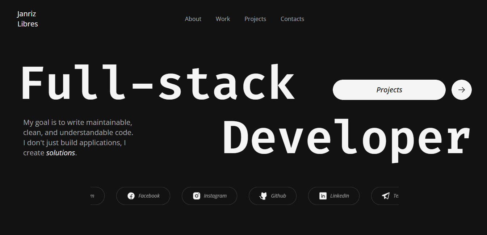

# Developer Portfolio

My first developer portfolio, a single-page site built from scratch with React, TypeScript and Vite. It shows my professional work, my projects and the ways to reach me. It has since been replaced by [portfolio-v2](https://github.com/janrizmlibres/portfolio-v2), but it still runs at [janrizlibres.vercel.app](https://janrizlibres.vercel.app).



## What's on the page

The page runs top to bottom through these sections.

- **Hero**, with a link down to the projects.
- **Socials**, a marquee of my links that scrolls in an endless loop.
- **About**, with the tools I use across the stack.
- **Professional work**, the projects I built on the job and the stack behind each one.
- **Projects**, featuring FlowStack, PulseVR and Mercado.
- **Footer.**

Animations on scroll and hover use [Motion](https://motion.dev/), and the layout is responsive with Tailwind CSS v4. The content lives in `src/data.ts` and in the section components under `src/components/`.

## Running it

You need Node.js and npm.

```bash
git clone https://github.com/janrizmlibres/dev-portfolio.git
cd dev-portfolio
npm install
npm run dev
```

The dev server opens on <http://localhost:5173>. No environment variables are needed.

| Script | What |
|---|---|
| `npm run dev` | Vite dev server |
| `npm run build` | Typecheck, then a production build into `dist/` |
| `npm run preview` | Serve the production build |
| `npm run lint` | ESLint |

## Stack

React 19, TypeScript 5, Vite 6, Tailwind CSS v4, Motion and Phosphor Icons.

## License

MIT. Released in 2025 by Janriz Libres.
